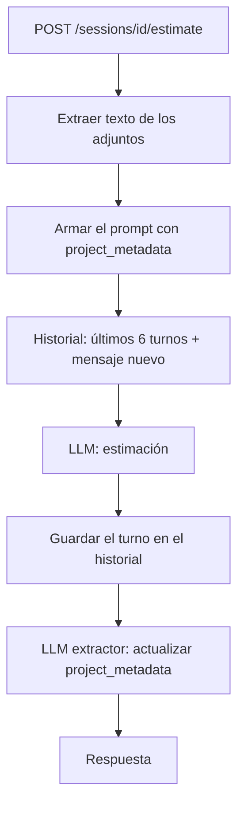

# Estimador CAG

Proyecto del máster de AI Engineering (LIDR). Recibe la transcripción de una reunión con un cliente y devuelve una estimación del proyecto (tareas, horas y coste) generada con un LLM.

Cada entrega está en su rama: `pre-session-02`, `pre-session-03`, etc. Cada una parte de la anterior.

## Cómo levantarlo

```bash
uv sync
cp .env.example .env   # completar las API keys
uv run uvicorn app.main:app --reload
```

Swagger queda en http://localhost:8000/docs.

## Tests

```bash
uv run pytest
uv run ruff check .
```

Ningún test llama al LLM de verdad, usan un proveedor falso.

## Sesión 05: memoria conversacional y adjuntos

El estimador ahora mantiene una conversación: se puede refinar el alcance en varios turnos y adjuntar documentos.

```bash
SID=$(curl -s -X POST localhost:8000/api/v1/sessions | jq -r .session_id)
curl -s localhost:8000/api/v1/sessions/$SID/estimate \
  -F transcript="Quieren una app de reservas para 3 gimnasios" \
  -F project_type=mobile_app -F attachments=@especificacion.pdf
```

Un turno, paso a paso:



### Historial y memoria

Son dos cosas separadas (`app/sessions.py`):

- **Historial** (`ConversationHistory`): los mensajes que viajan al modelo. Ventana deslizante de `MAX_TURNS=6` pares user/assistant; los más viejos se descartan. El system prompt no se guarda, se regenera en cada turno.
- **Memoria** (`ProjectMetadata`): nombre del proyecto, tamaño de equipo, tecnologías y alcance. Va en el system prompt dentro de `<project_metadata>` en todos los turnos, así que no se pierde aunque el turno donde se dijo ya haya salido de la ventana.

Las sesiones viven en un diccionario en memoria. Se pierden si se reinicia el servicio; para esta fase alcanza.

### Adjuntos: camino B (extracción local)

Extraigo el texto en el servicio (`pypdf` para PDF, `python-docx` para Word) y lo concateno a la transcripción con `--- attachment: nombre.pdf ---`.

Elegí B porque funciona igual con OpenAI y con Anthropic (ya tengo el wrapper con fallback), puedo ver qué texto entra al prompt y es lo que voy a necesitar para el chunking de RAG. Lo que se pierde son las imágenes y los diagramas. Un PDF escaneado sin texto se rechaza con 415.

Límites: 10 MB por archivo, 20.000 caracteres por adjunto y 5 adjuntos por turno.

### Cómo extraigo el project_metadata

Con un LLM extractor: después de cada turno hago una segunda llamada que devuelve un JSON con los campos y lo valido con Pydantic (`app/services/conversation.py`).

Probé pensarlo con regex pero para nombres de proyecto y alcance en texto libre era muy frágil. La llamada extra cuesta unos USD 0,0002 por turno con gpt-4o-mini. Si falla, me quedo con el metadata anterior y el turno sigue.

Limitación: las tecnologías se acumulan, así que si el cliente quita algo (por ejemplo los pagos) la tecnología sigue en la lista. El cambio sí queda en `agreed_scope`.

### Prueba con tres turnos

| Turno | Mensaje | Total |
|---|---|---|
| 1 | App de reservas para GymFit + PDF de especificación | 168 h |
| 2 | "Equipo de dos, y sumamos un panel web" | 226 h |
| 3 | "Sacamos los pagos online" | 191 h |

Las tecnologías del turno 1 (Stripe, Firebase, Node.js) salieron del PDF.

### Tests de integración

`tests/integration/test_sessions_api.py`, con `httpx.AsyncClient`:

1. Dos turnos en la misma sesión: el metadata se actualiza y el segundo prompt ya trae el nombre del proyecto.
2. La misma transcripción con y sin PDF: la estimación cambia.
3. Ocho turnos: al modelo nunca le llegan más de `MAX_TURNS`.

## Sesión 04: del chat al formulario

El chat dejaba el prompt en manos del usuario. Ahora el cliente manda parámetros tipados y el prompt lo arma el backend.

- `app/schemas.py`: `EstimationRequest` con `description`, `project_type`, `detail_level` y `output_format` (enums).
- `app/prompts/estimation/v1/`: el prompt pasó de un f-string a templates Jinja2 (`system.j2`, `user.j2`, `examples.j2`). `loader.py` expone `render_estimation_prompt(request, version)`, que devuelve `(system, user)`.
- Las versiones no se editan: un cambio es una carpeta nueva. Hay un `v2/` (más conservador, 25% de contingencia) y se elige con `?prompt_version=v2`. La respuesta dice con qué versión se generó.
- `POST /api/v1/prompt/preview` muestra el prompt renderizado sin llamar al modelo. Me sirvió para depurar.
- El cliente de Streamlit ahora es un `st.form`.
- Tests del template en `tests/prompts/`: no llaman al modelo, solo comprueban que cada opción del formulario mete la instrucción que corresponde.

Algo que encontré probando: con los ejemplos al final del prompt, gpt-4o-mini copiaba el formato de los ejemplos e ignoraba `output_format`. Lo resolví poniendo las instrucciones de formato después de los ejemplos.

## Sesión 03: chat en Streamlit con streaming

```bash
uv run streamlit run streamlit_app.py   # con la API levantada en otra terminal
```

- `streamlit_app.py`: chat con historial en `st.session_state`. La respuesta se ve en streaming (`st.write_stream`). En el sidebar se ve el system prompt con los ejemplos y las métricas de la última llamada.
- `POST /api/v1/chat/stream` (desde la sesión 04 es `/estimate/stream`): devuelve la respuesta en NDJSON, un fragmento por línea y al final las métricas.
- `app/services/providers.py`: una interfaz común para OpenAI y Anthropic. Si el proveedor principal falla se usa el otro (en streaming solo si falla antes del primer token).
- `app/services/cache.py`: caché exact-match en memoria. Si llega la misma conversación no se vuelve a llamar al modelo.
- Logs con structlog: un evento `llm.call` por llamada con tokens, coste y latencia.

## Sesión 02: scaffolding con FastAPI y CAG

- `POST /api/v1/estimate` recibía `{"transcription": "..."}` (desde la sesión 04 recibe el formulario tipado) y devuelve la estimación con el modelo, el proveedor, los tokens y el coste.
- `GET /health`.
- El contexto es CAG: las estimaciones de ejemplo de `app/context/examples.py` van dentro del system prompt en cada llamada. No hay base de datos ni búsqueda.
- Se puede usar OpenAI o Anthropic cambiando `LLM_PROVIDER` y `LLM_MODEL` en el `.env`.

Para probar hay una transcripción en `fixtures/transcripcion_ejemplo.txt`.
